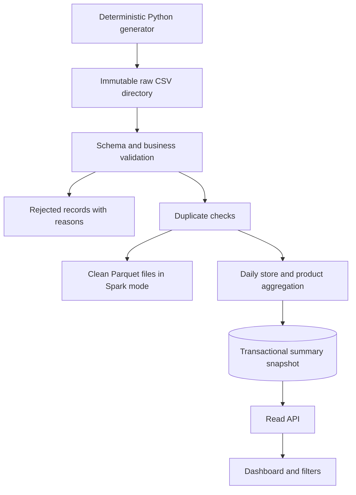
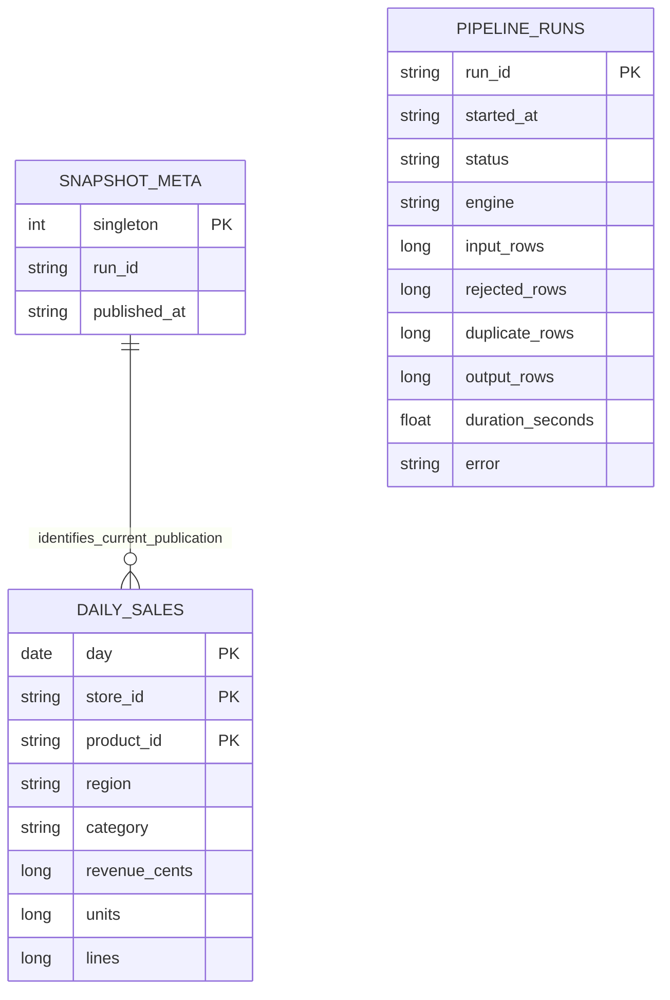
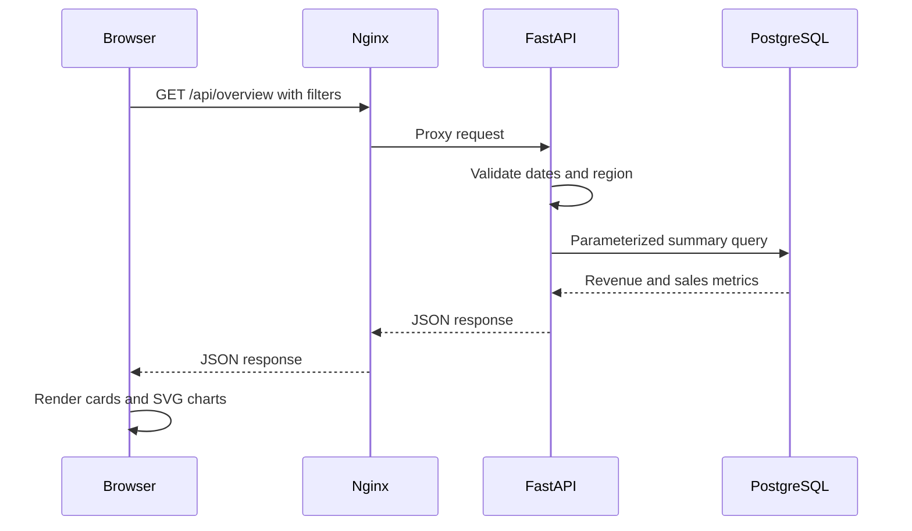
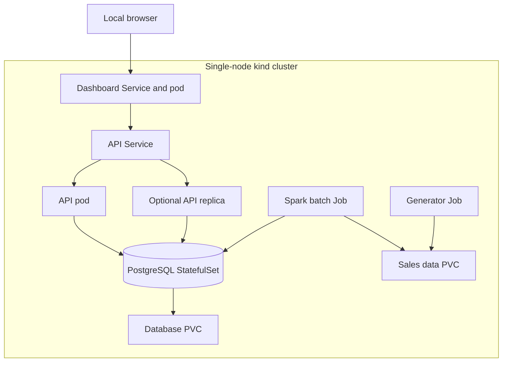

# Architecture and data semantics

## End-to-end data flow

Raw input is preserved. Every run writes into a unique run-ID directory. Spark creates Parquet datasets; the small reference engine writes JSONL for easy inspection. The reference engine keeps deduplication state in memory and is intended for smaller data, not distributed workloads.

The generator streams output, injects exact duplicates and invalid quantities, and atomically renames a completed staging directory. It refuses to overwrite existing input.

## Rules and amounts

- One record is one sale line. There are no receipt-level order counts.
- `sale_line_id`, `store_id`, and `product_id` must follow the documented ID format.
- IDs are checked for format, not against separate product/store master tables in this release.
- Regions and categories must belong to the configured enumerations.
- Dates use canonical `YYYY-MM-DD` calendar format.
- Numeric inputs have at most nine digits, quantity must be positive, and discount cannot exceed gross line revenue. Prices may be zero.
- Revenue is `quantity * unit_price_cents - discount_cents`; all values use EUR cents.
- Validation occurs before deduplication. Exact valid duplicates count once. Valid records with the same line ID and conflicting content fail the batch instead of selecting a random winner.
- Sales are grouped by day, store, region, product and category. Within a snapshot, a given day/store/product must have consistent region/category values; conflicting dimensions trigger a primary-key error and publication rollback.
- Empty or fully invalid datasets can publish an empty snapshot; the dashboard shows an empty state and the run report exposes rejection counts.

## Persistence

The diagram's publication association is conceptual: `daily_sales` contains only the current snapshot and has no foreign key to `snapshot_meta`. Actual DDL lives in `app/storage.py` and initializes automatically. Both SQLite and PostgreSQL use parameterized queries and explicit transactions.

Publication deletes old summaries and inserts replacements inside one transaction. PostgreSQL explicitly serializes competing snapshot writers. SQLite serializes writes. Readers do not observe a committed half-snapshot. A failed insert rolls the entire publication back. Reprocessing unchanged input gives identical totals and a new run history entry.

Run history is recorded after publication in a separate transaction. A forced process termination between these steps can leave a published snapshot without a matching completed run record. This demonstration does not implement a durable workflow coordinator or crash reconciliation. Failed pre-aggregation runs may report zero counters; these mean unavailable counts, not proof that no rows were inspected.

## Request flow

The Python-only preview replaces Nginx/FastAPI with a standard-library HTTP server, reusing the exact query functions. It serves the same frontend assets. The browser loads no external fonts or chart libraries and escapes dynamic table text.

## Kubernetes topology

Application Services provide stable internal addresses. The API can be scaled independently. The batch Job has bounded retries and unique output directories. A suspended CronJob provides optional scheduling. Two PVCs preserve inputs/outputs and database files. Readiness probes keep unready API/web pods out of Service endpoints.

The Spark driver and execution threads share one pod in this release. Distributed Spark on Kubernetes is a separate extension requiring executor-capable images, driver networking, RBAC, and storage reachable by all executors. The current local filesystem/PVC layout should not be presented as a production distributed data lake.

## Portfolio demonstration

1. Generate synthetic data and inspect intentionally invalid rows.
2. Process it with Spark and inspect clean/rejected outputs and run metrics.
3. Show the filtered dashboard and API JSON.
4. Reprocess the input and prove revenue does not double.
5. Show a failed input Job and unchanged published totals.
6. Scale API replicas and observe pod replacement.
7. Publish measured benchmark charts with machine specifications and limitations.
